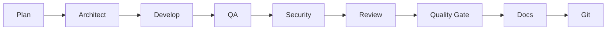
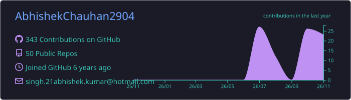
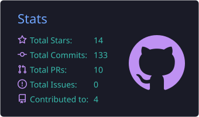
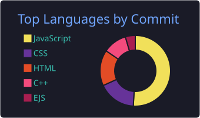
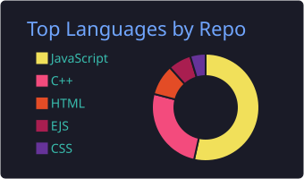
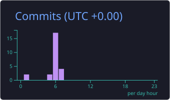

<div align="center">


</div>

<!-- Profile card -->
<table align="center">
  <tr>
    <td align="center" width="280">
      
      <br/><br/>
      <b>Abhishek Chauhan</b><br/>
      <sub>AI Agents • ML • Mobile • Full-Stack</sub>
      <br/><br/>
      <a href="https://abhishek-portfolio-3.netlify.app"></a>
    </td>
    <td valign="middle" width="560">
      <a href="https://github.com/AbhishekChauhan2904">
        
      </a>
      <br/><br/>
      🤖 Author of <b>AgentForge</b>, an AI workflow CLI<br/>
      📈 Going deep on <b>Machine Learning</b><br/>
      📱 Building with <b>Flutter</b> and <b>React Native</b><br/>
      🐳 Shipping with <b>Docker</b><br/>
      <br/>
      
      <br/><br/>
      
      
    </td>
  </tr>
</table>

## 🚀 AI Builder • ML Learner • Full-Stack & Mobile Developer

---

<div align="center">


</div>

---

## 🧠 About Me

- 💻 macOS developer building **AI agents, LLM-powered tools and cross-platform mobile apps**
- 🤖 Author of **AgentForge**, an open-source CLI that turns AI coding tools into a structured engineering team
- 📈 Going deep on **Machine Learning**, from fundamentals to real projects
- ⚙️ Comfortable close to the metal in **C and C++**, and productive in **Java, Python and TypeScript**
- 📱 Building mobile apps with **Flutter** and **React Native** (Android Studio and Xcode)
- 🐳 Packaging and shipping everything with **Docker**
- 🌱 Always learning, always building
- 👯 Open to collaborating on AI agents, ML projects and developer tools

## 🎯 Current Focus

| | Focus area | What I'm doing |
|---|---|---|
| 🤖 | **LLMs & AI Agents** | Multi-agent workflows, tool use, prompt and workflow engineering |
| 📈 | **Machine Learning** | Core ML concepts, model training, evaluation and practical projects |
| 📱 | **Mobile Development** | Flutter and React Native apps for Android and iOS |
| 🧩 | **Developer Tooling** | CLIs, automation and better developer experience |
| 🧪 | **Systems & Algorithms** | Problem solving in C, C++ and Java |

---

## 🔥 Featured: AgentForge

<div align="center">

[](https://www.npmjs.com/package/@abhishekchauhan2904/agentforge)
[](https://www.npmjs.com/package/@abhishekchauhan2904/agentforge)
[](https://github.com/AbhishekChauhan2904/agentforge)


</div>

**AgentForge** turns **Cursor**, **OpenCode** or **Gemini CLI** into a structured AI engineering team, with human approval at every step. It doesn't build your app. It builds the **AI workflow around your app**, and enforces it in code instead of relying on prompts alone.



```bash
npm install -g @abhishekchauhan2904/agentforge

cd your-project
agentforge init                              # pick tool, workflow, specialists
agentforge start "add admin ticket management"
agentforge next                              # tells you what to say to your AI
agentforge approve                           # verifies the report, moves to the next step
```

**Highlights**

- 🧭 Human-approved pipeline: `start`, `next`, `approve`, `status`
- 🛡️ Quality gate runs tests, lint, build, audit and a secret scan, and blocks commits that fail
- ☁️ AWS / Azure checks, 🐳 Docker scaffolding and linting, 🗺️ Mermaid project graphs
- 🔌 Works with **Cursor, OpenCode and Gemini CLI**

---

## 🛠️ Tech Stack

**Languages**

<p>
  
</p>

**AI / Machine Learning**

<p>
  
</p>

**Mobile**

<p>
  
</p>

**Web, Backend & Tools**

<p>
  
</p>

---

## 🤖 Featured Projects

| Project | Description | Stack |
|---|---|---|
| [**agentforge**](https://github.com/AbhishekChauhan2904/agentforge) | CLI that turns AI coding tools into a structured engineering workflow | JavaScript • Node.js |
| [**pickup-counter**](https://github.com/AbhishekChauhan2904/pickup-counter) | Browse snacks, build a cart, pay via simulated UPI/card/net-banking, and claim the order at a locker | TypeScript |
| [**chatbot**](https://github.com/AbhishekChauhan2904/chatbot) | LLM chatbot built on the Groq API | JavaScript |
| [**doc-saas**](https://github.com/AbhishekChauhan2904/doc-saas) | Demo doctor portal | JavaScript |
| [**imagesearch**](https://github.com/AbhishekChauhan2904/imagesearch) | Image search using a third-party API | JavaScript |
| [**mini-job-board-application**](https://github.com/AbhishekChauhan2904/mini-job-board-application) | Mini job portal | JavaScript |

---

## 📊 GitHub Metrics

<p align="center">
  
  
</p>

<p align="center">
  
  
</p>

<p align="center">
  
</p>

<p align="center">
  
</p>

---

## 🔗 Connect with Me

<div align="center">

[](https://abhishek-portfolio-3.netlify.app)
[](https://www.linkedin.com/in/abhishek-kumar-6946a3188/)
[](https://x.com/Abhishek290004)
[](mailto:singh.21abhishek.kumar@gmail.com)

<br/>

*"Coding is my passion."* 💭


</div>
